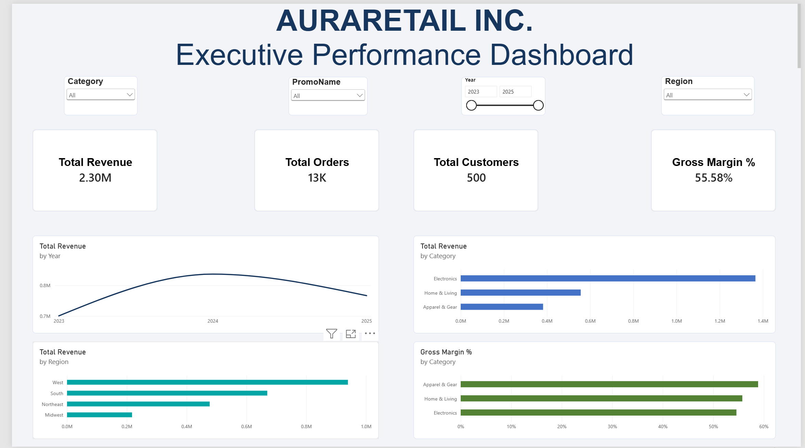
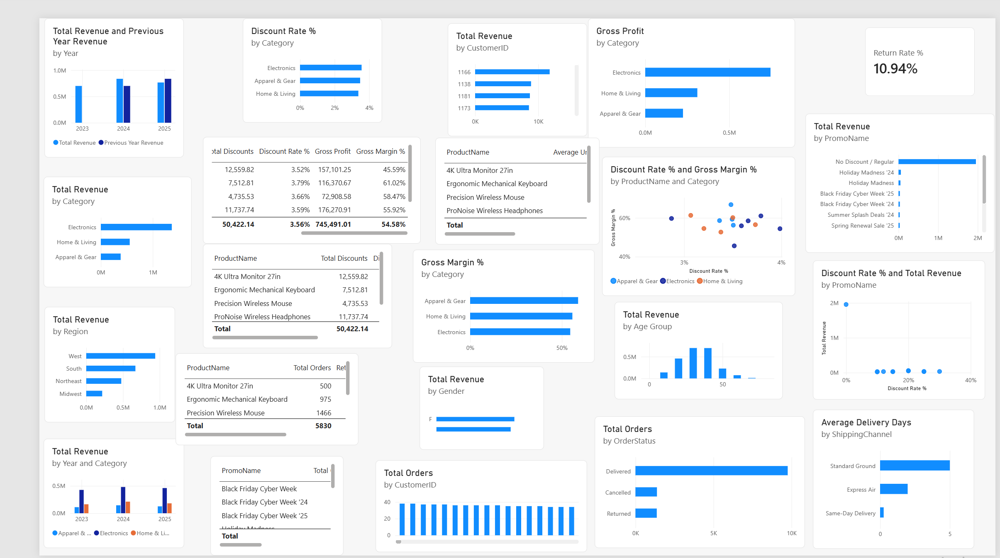

# AuraRetail Inc. | Power BI Business Intelligence & Analytics

## Project Overview

AuraRetail Inc. is a fictional omnichannel retail company selling consumer electronics, home goods, and outdoor apparel across North America.

This project uses Microsoft Power BI to develop an interactive business intelligence solution that consolidates sales, customer, product, promotion, and geographical data into an executive dashboard.

The analysis focuses on understanding business performance, identifying profitability challenges, and providing management with insights to support better commercial decisions.

## Business Problem

Despite experiencing revenue growth between 2023 and 2025, AuraRetail faces concerns about declining profitability and potential operational inefficiencies.

Management needs a consolidated view of business performance to understand:

- How revenue and gross margins are changing over time.
- Which product categories and regions contribute most to revenue.
- Whether certain products have weaker profitability.
- How product returns vary across the product portfolio.
- How promotional discounting relates to sales performance.

## Project Objectives

The objectives of this project were to:

1. Integrate multiple business datasets into a unified analytical model.
2. Clean and prepare the data for analysis.
3. Develop a relational data model using Power BI.
4. Create DAX measures to calculate key performance indicators.
5. Explore sales, profitability, returns, and promotional performance.
6. Build an interactive executive dashboard to communicate key findings.

## Dataset Description

The project uses seven synthetic CSV datasets:

| Dataset | Description |
|---|---|
| `fact_sales` | Transaction-level sales, revenue, costs, discounts, quantities, and order information |
| `dim_customer` | Customer information and demographic attributes |
| `dim_product` | Product names, categories, and supplier relationships |
| `dim_supplier` | Supplier information |
| `dim_geography` | Geographical information, including regions and states |
| `dim_promotion` | Promotional campaign names and discount information |
| `dim_date` | Calendar and date attributes |

The fact table contains 12,500 transaction records. The date dimension covers the 2023–2025 reporting period.

All datasets are synthetic and created for this portfolio project.

## Data Cleaning and Preparation

Data preparation was performed using Power Query.

Key activities included:

- Removing exact duplicate records from the customer dimension.
- Standardising product category naming conventions.
- Standardising state names in the geographical dimension.
- Reviewing missing values and retaining them where there was insufficient evidence to populate them accurately.
- Inspecting inconsistent or unusual values for further consideration rather than automatically modifying them.

The objective was to improve data consistency while preserving the integrity of the original information.

## Data Modelling

A relational model was developed in Power BI using one-to-many relationships.

The model connects the sales fact table to the relevant dimensions, including customer, product, promotion, and date. Additional relationships connect suppliers to products and geographical information to customers.

A dedicated date table was configured and marked as the official date table.

A separate measures table was also created to organise DAX calculations.

## Key Performance Indicators and DAX

DAX measures were developed to calculate the main business performance indicators.

These included:

- Total Revenue
- Total Orders
- Total Customers
- Total Quantity Sold
- Total Costs
- Gross Profit
- Gross Margin %
- Average Order Value
- Previous Year Revenue
- Revenue Year-over-Year Growth %
- Total Discounts
- Discount Rate %
- Returned Orders
- Return Rate %
- Average Delivery Days

These measures support the analysis of sales performance, profitability, discounting, returns, and fulfilment.

## Exploratory Analysis and Key Findings

Three focused investigations were conducted.

### 1. Electronics Profitability

The analysis compared revenue, discount rates, unit costs, and gross margins across six electronic products.

Key finding:

The 4K Ultra Monitor 27in generated €344,631.25 in revenue but had the lowest gross margin among the six products at 45.59%.

Its average unit cost of €210 was substantially higher than the other products examined. Its discount rate was 3.52%, which was not the highest in the group.

This suggests that product cost structure may be a more relevant area for further investigation than unusually high discounting alone.

### 2. Product Returns

The investigation compared order volumes and return rates across the six electronic products.

Key findings:

- The Ergonomic Mechanical Keyboard recorded the highest return rate at 11.18%.
- The 4K Ultra Monitor 27in recorded the lowest return rate at 9.40%.
- The difference between the highest and lowest rates was 1.78 percentage points.

Although some differences exist, return rates were relatively close across the products.

The dataset did not contain return-reason information, so the analysis could not establish why customers returned particular products.

### 3. Promotional Performance

Promotional campaigns were compared using order volumes, revenue, discount amounts, and discount rates.

Key findings:

- Regular, non-promotional orders accounted for 10,216 of the 12,500 orders, approximately 81.7%.
- Holiday Madness '24 generated the highest revenue among the discounted campaigns examined, at €59,746.67.
- Black Friday Cyber Week '25 had the highest discount rate at 30%, with €14,669.31 in discounts.

The results show that higher discount rates do not automatically correspond to higher revenue.

However, determining the true incremental effectiveness or profitability of individual campaigns would require additional information, such as campaign costs, customer exposure, and a suitable non-promotional comparison.

## Executive Dashboard

The executive dashboard brings the main business performance indicators together in one interactive report.

It includes:

**KPI Cards**
- Total Revenue
- Total Orders
- Total Customers
- Gross Margin %

**Visualisations**
- Revenue Trend
- Revenue by Category
- Revenue by Region
- Gross Margin by Category

**Interactive Filters**
- Year
- Product Category
- Region
- Promotion

The dashboard is designed to help management monitor business performance and explore results across different business dimensions.

### AuraRetail_Executive_Dashboard_ Exploratory Analysis.png

#### AuraRetail_Executive_Dashboard_ Executive Dashboard.png

#### Exploratory Analysis

## Business Recommendations

Based on the analysis, the following areas merit management attention:

1. **Review electronics cost structures:** Investigate the cost drivers affecting the profitability of the 4K Ultra Monitor 27in.
2. **Monitor product returns:** Review the Ergonomic Mechanical Keyboard's return performance and collect return-reason data to identify potential causes.
3. **Evaluate promotional effectiveness:** Assess promotional campaigns using incremental revenue and profit rather than revenue alone.
4. **Monitor profitability alongside revenue:** Track gross margin as well as sales growth to ensure revenue expansion translates into sustainable financial performance.

These recommendations identify areas for further management investigation; they should not be interpreted as proven causal conclusions.

## Limitations and Opportunities for Improvement

The project is based on synthetic data and is intended to demonstrate business intelligence and analytical capabilities.

Some limitations include:

- No detailed product return reasons.
- No campaign exposure or marketing expenditure data.
- No controlled baseline for measuring incremental promotional sales.
- Limited information for explaining changes in fulfilment and logistics costs.

Future improvements could include incorporating these additional data points and developing more detailed profitability and operational performance reporting.

## Tools and Technologies

- Microsoft Power BI Desktop
- Power Query
- DAX
- Microsoft Excel
- CSV datasets
- GitHub

## Project Deliverables

- Interactive Power BI report (`.pbix`).
- Exploratory analysis dashboard.
- Executive dashboard.
- Seven supporting CSV datasets.
- Project documentation.

---

**Project Type:** Business Intelligence | Data Analytics | Retail Analytics

**Reporting Period:** 2023–2025

**Data:** Synthetic portfolio dataset
